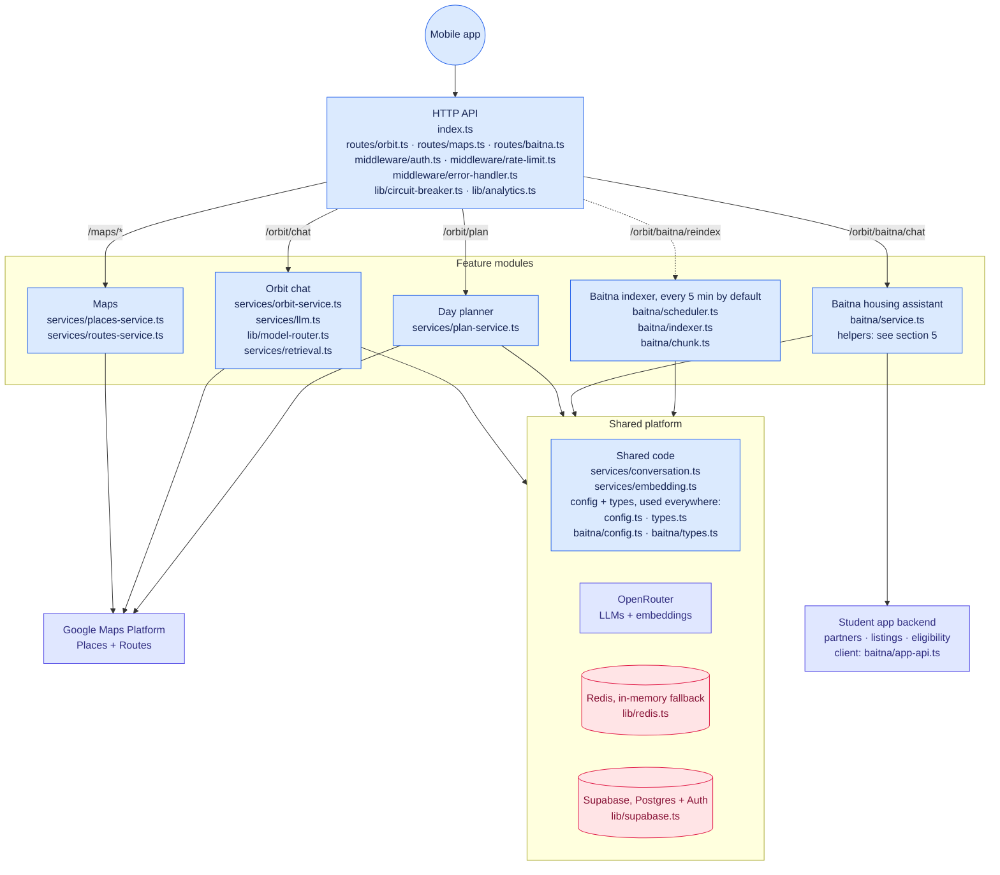
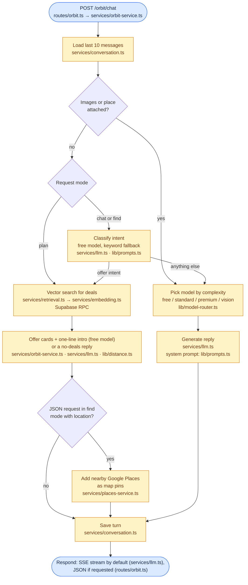
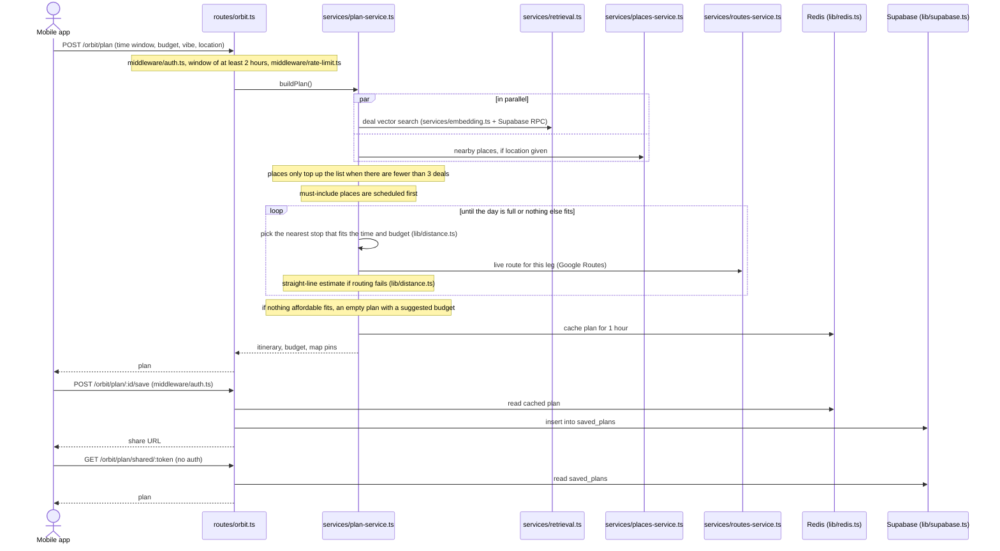
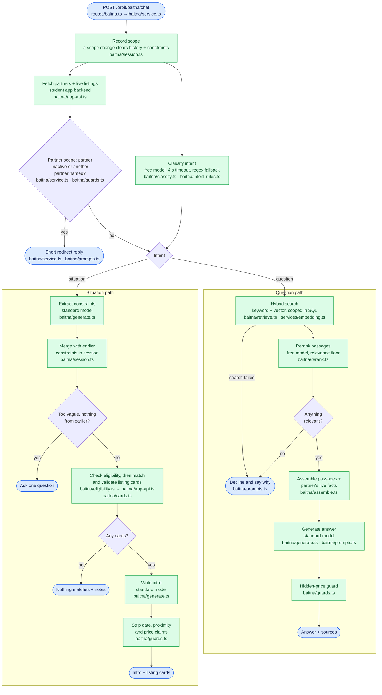
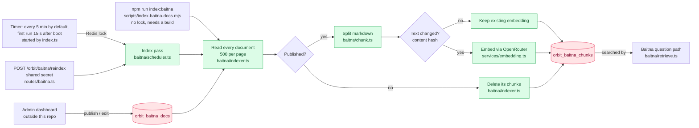

# Orbit backend architecture

How the Orbit backend is put together. Start with the overview, then open the flow for the feature you care about. The two tables are the reference for which checks each endpoint runs and who uses which store and model. File paths are relative to `src/`, except `scripts/`.

## 1. Overview

Almost everything uses the shared platform, so the picture draws one arrow to the group instead of one per service. [Who uses what](#6-who-uses-what) has the details.

## 2. Request handling

Every endpoint, and the checks it runs before the feature code.

| Endpoint | Auth | Rate limit | Circuit breaker | Handled by |
|---|---|---|---|---|
| `POST /orbit/chat` | yes | yes | yes | `services/orbit-service.ts`: SSE stream by default, JSON if the client asks |
| `POST /orbit/plan` | yes | yes | no | `services/plan-service.ts` |
| `POST /orbit/plan/:id/save` | yes | no | no | route reads the cached plan from Redis and writes `saved_plans` |
| `GET /orbit/plan/shared/:token` | **none** | no | no | route reads `saved_plans` |
| `GET /maps/places/autocomplete`, `GET /maps/places/details` | yes | no | no | `services/places-service.ts` |
| `POST /maps/routes` | yes | no | no | `services/routes-service.ts` |
| `POST /orbit/baitna/chat` | yes | yes | yes | `baitna/service.ts` |
| `POST /orbit/baitna/reindex` | shared secret (`x-reindex-secret`) | no | no | `baitna/scheduler.ts` |
| `GET /`, `GET /orbit/health`, `GET /orbit/baitna/health` | none | no | the two `/health` routes report it | route |

- **Auth** (`middleware/auth.ts`) checks the bearer token with Supabase Auth and loads the `users` row. If the request sends an `X-Device-ID` header, the first ID seen is bound to the user and a different one later gets a 403. Requests without the header skip the device check.
- **Rate limit** (`middleware/rate-limit.ts`) allows 10 requests per 60 s and 150 per day for each user by default (`VELOCITY_LIMIT`, `VELOCITY_WINDOW`, `DAILY_CHAT_LIMIT`). Orbit chat, Orbit plan and Baitna chat share both counters. The counters live in Redis.
- **Circuit breaker** (`lib/circuit-breaker.ts`) is a single in-process breaker shared by Orbit chat and Baitna chat. It opens when 5 different users have failed with no successful request in between. While it is open (60 s), both chats and both `/health` routes answer 503. Orbit chat only counts timeouts as failures, because `services/orbit-service.ts` catches its other errors and replies itself. Baitna chat counts every error except rate limits and 4xx answers from the student app backend.
- **Feature flag:** when `FEATURE_SV_ORBIT_ENABLED` is off (it is on by default), Orbit chat, Baitna chat and both `/health` routes answer 503. Plans, maps and shared links keep working. Baitna chat also answers 404 when the student app backend reports Baitna as switched off.
- **Analytics** (`lib/analytics.ts`): both chat routes write an `analytics_events` row without waiting for it. Baitna chat logs only successful replies. Orbit chat also logs requests that ended in an error reply, because the service handles those errors itself.

## 3. Orbit chat

## 4. Day planner

## 5. Baitna housing assistant

Every reply from `baitna/service.ts` is saved to conversation history (`services/conversation.ts`), including early exits and declines. Error responses from the route, such as timeouts and rate limits, are not. After a timeout the work keeps running, so the turn is still saved if it finishes late. Only the situation path turns live listings into cards. The question path uses the selected partner's current listings only as background facts, and the situation path never searches documents.

### Keeping Baitna's documents searchable

## 6. Who uses what

| Store / service | What lives there or is called | Used by |
|---|---|---|
| **Supabase** (Postgres + Auth) | Auth token check, `users` | auth middleware |
| | `match_offers_tickets_and_deals` RPC (vector search over offers, tickets, online deals) | Orbit chat, day planner |
| | `saved_plans` | save / share plan routes |
| | `analytics_events` | both chat routes |
| | `orbit_baitna_docs`, `orbit_baitna_chunks`, `orbit_baitna_search` RPC | Baitna indexer (writes), Baitna question path (reads) |
| **Redis** (in-memory fallback when `REDIS_URL` is unset, is `redis://localhost:6379`, or can't be reached) | `orbit:conversation:{user}:{session}`, 24 h, last 20 messages | Orbit chat, Baitna |
| | `orbit:plan:{id}`, 1 h | day planner writes, save route reads |
| | `limit:velocity:{user}`, `limit:daily:{user}:{date}` | rate limiter |
| | `orbit:baitna:scope:*`, `orbit:baitna:constraints:*`, 24 h | Baitna session |
| | `orbit:baitna:index:lock` | indexer timer |
| **OpenRouter** | `MODEL_FREE` | Orbit intent, offer one-liner, simple chat; Baitna classifier, reranker |
| | `MODEL_STANDARD` / `MODEL_PREMIUM` / `MODEL_VISION` | Orbit conversation, picked by `lib/model-router.ts` |
| | `MODEL_STANDARD` | Baitna answers, constraint extraction, intros |
| | `openai/text-embedding-3-small` | offer search, Baitna search, indexer |
| **Google Maps Platform** | Places (nearby, autocomplete, details) and Routes | maps routes, Orbit chat (JSON find mode), day planner |
| **Student app backend** | `/baitna/partners` (partners + listings), `/baitna/eligibility`, called with the student's own token | Baitna |
